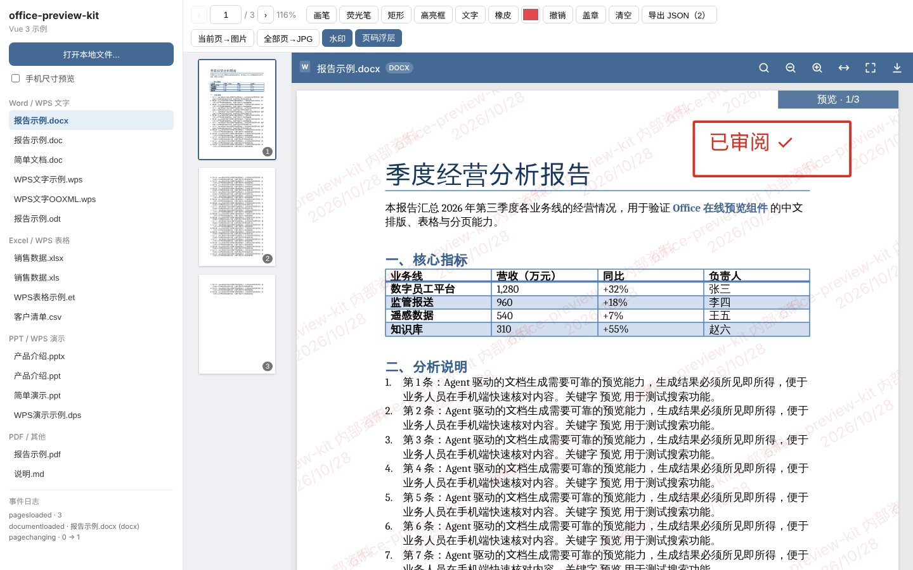
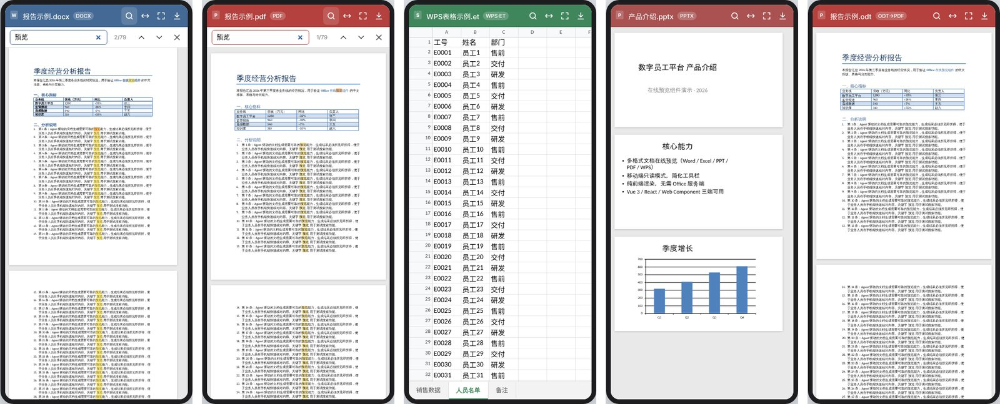
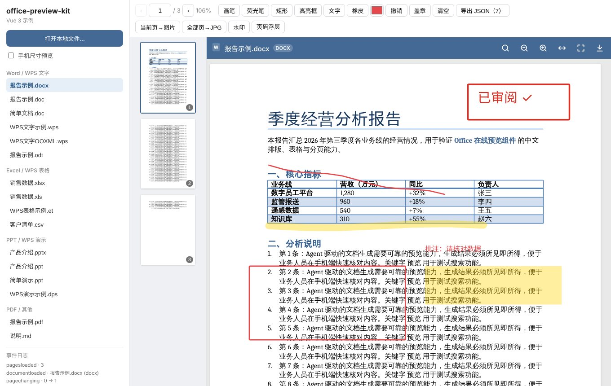

# office-preview-kit 使用手册

> 纯前端、只读的 **Office / WPS / PDF 在线预览组件**。同一个核心可在 **Vue 3**、**React**、**Web Component** 和原生 JS 中使用。界面仿照 OnlyOffice 移动端只读模式：工具栏精简，手机和 PC 都能用。另外提供与 pdf.js 一致的翻页事件、页面批注 / 绘制层、页面渲染为图片，以及浮层（水印等）叠加。



---

## 目录

1. [特性一览](#1-特性一览)
2. [格式支持](#2-格式支持)
3. [安装与环境要求](#3-安装与环境要求)
4. [快速开始](#4-快速开始)
5. [构建工具与部署配置](#5-构建工具与部署配置)
6. [属性与选项](#6-属性与选项)
7. [事件](#7-事件)
8. [实例方法](#8-实例方法)
9. [翻页与缩放（pdf.js 兼容）](#9-翻页与缩放pdfjs-兼容)
10. [批注与绘制层](#10-批注与绘制层)
11. [页面渲染为图片](#11-页面渲染为图片)
12. [页面浮层与水印](#12-页面浮层与水印)
13. [独立渲染（不挂载预览器）](#13-独立渲染不挂载预览器)
14. [服务端转换（convert 钩子）](#14-服务端转换convert-钩子)
15. [样式、主题与国际化](#15-样式主题与国际化)
16. [TypeScript 类型](#16-typescript-类型)
17. [常见问题](#17-常见问题)
18. [已知限制](#18-已知限制)
19. [依赖与许可](#19-依赖与许可)

---

## 1. 特性一览

| 能力 | 说明 |
|---|---|
| 多格式预览 | DOCX / XLSX / PPTX、DOC / XLS / PPT（实验性）、WPS 文字 / 表格 / 演示、PDF、CSV、TXT / MD、图片 |
| 纯前端渲染 | Office 文件通过 WebAssembly + Canvas 在浏览器中渲染，**不需要部署 Office 服务端** |
| 移动端只读样式 | 仿 OnlyOffice 移动端：按文档类型着色的顶栏、连续滚动、浮动页码、表格底部 Sheet 标签、双指缩放 |
| PC 端适配 | 组件宽度大于 560px 时显示缩放按钮，支持 Ctrl/⌘ + 滚轮缩放、Ctrl/⌘ + F 搜索、全屏 |
| 文档搜索 | 所有格式都可搜索，支持上一个 / 下一个，PDF 中高亮命中位置 |
| pdf.js 兼容 API | `eventBus.on('pagechanging')`、`currentPageNumber`、`currentScale`、`scrollPageIntoView` 等 |
| 批注 / 绘制层 | 画笔、荧光笔、矩形、高亮框、文字、橡皮、自定义工具；可导出 JSON 持久化 |
| 页面渲染为图片 | 当前页、指定页、批量、表格指定区域；合成时可带批注和浮层 |
| 浮层叠加 | 同一个绘制函数，既实时显示在屏幕上，也会合成进导出的图片（水印、页码、印章等） |
| 独立渲染 | 不挂载预览器也能把文件的任意页渲染成图片（文件列表缩略图、批量出图） |
| 服务端转换兜底 | 浏览器无法渲染的格式（ODF、RTF、部分 WPS / DOC / PPT）自动交给你的转换服务 |
| SSR 安全 | 可在 Nuxt / Next.js 服务端渲染环境中被导入，不会报错 |



---

## 2. 格式支持

| 格式 | 浏览器直接渲染 | 说明 |
|---|:---:|---|
| `.docx` `.docm` `.dotx` | ✅ | 分页排版，支持页眉页脚、表格、图片、编号、脚注、中文排版 |
| `.xlsx` `.xlsm` `.xltx` | ✅ | 多工作表、冻结窗格、条件格式、图表；**公式只显示文件中缓存的结果** |
| `.pptx` `.pptm` `.ppsx` `.potx` | ✅ | 母版、布局、图表、备注；**不播放动画和切换效果** |
| `.pdf` | ✅ | 基于 pdf.js，懒加载渲染 |
| `.csv` `.tsv` | ✅ | 自动识别 UTF-8 / GB18030 编码；所有字段按文本显示 |
| `.xls`、WPS 表格 `.et` `.ett` | ✅ 实验性 | 旧版二进制读取器（BIFF8 子集） |
| `.doc` `.ppt`、WPS 文字 `.wps` `.wpt`、WPS 演示 `.dps` `.dpt` | ⚠️ 实验性 | 先尝试直接读取，读取器不支持时转交 `convert` |
| `.odt` `.ods` `.odp`、`.rtf`、`.xlsb`、`.ofd` | ➡️ | 需要配置 [`convert`](#14-服务端转换convert-钩子) |
| `.txt` `.md` `.json` `.xml` `.log` 等 | ✅ | 纯文本显示，支持搜索 |
| `.png` `.jpg` `.gif` `.webp` `.bmp` `.svg` | ✅ | 图片显示，支持缩放和批注 |

**格式识别依据文件内容，而不是扩展名。** 组件会读取 ZIP 目录和 OLE2 复合文档的流名，判断文件的真实格式：

- 以 OOXML 格式保存的 `.wps` 按 DOCX 渲染；
- 含有 `WordDocument` / `Workbook` / `PowerPoint Document` 流的 WPS 二进制文件，按 DOC / XLS / PPT 渲染；
- WPS 私有二进制结构、加密文件等无法渲染的文件，会给出明确的错误原因；如果配置了 `convert`，则自动转换后再预览。

> ⚠️ 旧版 DOC / PPT 读取器支持的范围很窄，实测中不少文件会被拒绝（错误码 `unsupported-content`）。**如果业务中有较多 DOC / PPT / WPS 文件，建议配置服务端转换。**

---

## 3. 安装与环境要求

```bash
npm i office-preview-kit
# 或
pnpm add office-preview-kit
```

- **框架**：`vue >= 3.2` 和 `react >= 17` 都是**可选**的 peerDependency，只在用到对应包装组件时才需要安装。
- **浏览器**：需要支持 ES2020、WebAssembly、Web Worker 和 `createImageBitmap` 的现代浏览器（Chrome / Edge / Firefox 最新版、iOS / macOS Safari 较新版本）。上线前请在目标浏览器上实测。
- **模块格式**：仅提供 ESM。
- **入口**：

| 导入路径 | 内容 |
|---|---|
| `office-preview-kit` | 核心类 `OfficeViewer`、独立渲染函数、工具函数与全部类型 |
| `office-preview-kit/vue` | Vue 3 组件 |
| `office-preview-kit/react` | React 组件 |
| `office-preview-kit/element` | 导入后自动注册 `<office-viewer>` 自定义元素 |

各格式的渲染器**按需动态加载**：打开 PDF 时不会下载 Office 解析器，反之亦然。

---

## 4. 快速开始

> **组件必须有明确的高度**（例如 `height: 100vh` 或父容器的固定高度），否则内容区高度为 0，什么也显示不出来。

### 4.1 Vue 3

```vue
<script setup lang="ts">
import { ref } from 'vue';
import { OfficeViewer } from 'office-preview-kit/vue';

const src = ref<string | File>('/files/季度报告.docx');
const viewer = ref<InstanceType<typeof OfficeViewer>>();

function onPick(e: Event) {
  const f = (e.target as HTMLInputElement).files?.[0];
  if (f) src.value = f;            // 可以直接传 File
}
</script>

<template>
  <input type="file" @change="onPick" />
  <div style="height: 80vh">
    <OfficeViewer
      ref="viewer"
      :src="src"
      locale="zh-CN"
      @load="(info) => console.log('已加载', info)"
      @error="(err) => console.error(err.code, err.message)"
      @pagechanging="(e) => console.log('第', e.pageNumber, '页')"
    />
  </div>
  <button @click="viewer?.nextPage()">下一页</button>
</template>
```

### 4.2 React

```tsx
import { useRef, useState } from 'react';
import { OfficeViewer, type OfficeViewerRef } from 'office-preview-kit/react';

export default function Preview() {
  const [src, setSrc] = useState<string | File>('/files/产品介绍.pptx');
  const ref = useRef<OfficeViewerRef>(null);
  return (
    <>
      <input type="file" onChange={(e) => e.target.files?.[0] && setSrc(e.target.files[0])} />
      <OfficeViewer
        ref={ref}
        src={src}
        style={{ height: '80vh' }}
        onLoad={(info) => console.log(info)}
        onPageChanging={(e) => console.log(e.pageNumber)}
      />
      <button onClick={() => ref.current?.nextPage()}>下一页</button>
    </>
  );
}
```

### 4.3 Web Component（Angular、Svelte、jQuery、纯 HTML 均可用）

```html
<script type="module">
  import 'office-preview-kit/element';

  const el = document.querySelector('office-viewer');
  el.addEventListener('ov-load', (e) => console.log(e.detail));
  el.addEventListener('ov-pagechanging', (e) => console.log(e.detail.pageNumber));

  // 传 File / Blob / ArrayBuffer 时用 property
  // el.source = file;
  // 其他选项
  // el.options = { watermark: '内部资料' };
</script>

<office-viewer src="/files/a.pdf" locale="zh-CN" style="height:600px"></office-viewer>
```

| 属性（attribute） | 说明 |
|---|---|
| `src` | 文件 URL |
| `file-name` | 文件名（作为格式识别的提示，同时用作标题） |
| `locale` | `zh-CN` / `en` |
| `title-text` | 顶栏标题 |
| `toolbar="false"` | 隐藏顶栏 |
| `download="false"` | 隐藏下载按钮 |

元素的 `viewer` 属性就是核心实例，所有[实例方法](#8-实例方法)都可以通过 `el.viewer.xxx()` 调用。

### 4.4 原生 JS（核心类）

```ts
import { OfficeViewer } from 'office-preview-kit';

const viewer = new OfficeViewer(document.getElementById('box')!, { locale: 'zh-CN' });
await viewer.open(file);                 // URL / File / Blob / ArrayBuffer / Uint8Array
viewer.eventBus.on('pagechanging', (e) => console.log(e.pageNumber));
// 用完后释放
viewer.destroy();
```

### 4.5 完整示例

仓库中的 [`example-vue/`](example-vue/) 是一个可以直接运行的 Vue 3 示例，通过 npm 安装 `office-preview-kit`。它演示了多格式预览、翻页条、绘制工具栏、导出图片、缩略图、水印、页码浮层和服务端转换：

```bash
cd example-vue
npm install
npm run dev   # http://localhost:5173
```

---

## 5. 构建工具与部署配置

### 5.1 Vite（推荐 Vite 8）

```ts
// 推荐：让 PDF 在 Worker 中解析，避免阻塞主线程
import pdfWorkerSrc from 'pdfjs-dist/build/pdf.worker.min.mjs?url';
const options = { pdfWorkerSrc };
```

- **Vite 8**：开发和生产构建都无需额外配置。
- **Vite 7 开发服务器**：需要排除依赖预构建，否则 WASM 资源路径会出错（生产构建不受影响）：

```ts
// vite.config.ts
export default defineConfig({
  optimizeDeps: { exclude: ['@silurus/ooxml', '@silurus/ooxml-legacy-office'] },
});
```

### 5.2 webpack 5 / Next.js

WASM 通过标准的 `new URL('…', import.meta.url)` 方式引用，webpack 5 和 Next.js（Turbopack）可直接使用。PDF Worker 地址可以这样写：

```ts
const pdfWorkerSrc = new URL('pdfjs-dist/build/pdf.worker.min.mjs', import.meta.url).toString();
```

### 5.3 SSR（Nuxt / Next.js）

包可以在服务端被安全地导入，但**渲染必须在客户端进行**：

```vue
<!-- Nuxt -->
<ClientOnly><OfficeViewer :src="src" /></ClientOnly>
```

```tsx
// Next.js App Router
'use client';
import dynamic from 'next/dynamic';
const OfficeViewer = dynamic(() => import('office-preview-kit/react').then((m) => m.OfficeViewer), { ssr: false });
```

### 5.4 内网 / 离线部署

默认情况下，pdf.js 的字符映射（CMap）和标准字体从 jsDelivr CDN 加载，**中文 PDF 依赖 CMap**。内网环境请自行托管：

```bash
# 构建时把文件复制到静态目录
cp -r node_modules/pdfjs-dist/cmaps          public/pdfjs/cmaps
cp -r node_modules/pdfjs-dist/standard_fonts public/pdfjs/standard_fonts
```

```ts
const options = {
  pdfWorkerSrc,
  pdfCMapUrl: '/pdfjs/cmaps/',                       // 必须以 / 结尾
  pdfStandardFontDataUrl: '/pdfjs/standard_fonts/',  // 必须以 / 结尾
  useGoogleFonts: false,                             // 默认就是 false
};
```

其余资源（Office 解析器的 `.wasm`、Worker 脚本）都由构建工具打包进你自己的产物，**运行时不访问任何外部网络**。

---

## 6. 属性与选项

### 6.1 组件属性（Vue / React）

| 属性 | 类型 | 默认值 | 说明 |
|---|---|---|---|
| `src` | `string \| URL \| File \| Blob \| ArrayBuffer \| Uint8Array` | – | 文件来源；字符串按 URL 处理。变化时自动重新加载 |
| `fileName` | `string` | 自动推断 | 用作标题和格式识别的提示。传 Blob / ArrayBuffer 时建议提供 |
| `locale` | `'zh-CN' \| 'en'` | `'zh-CN'` | 界面语言 |
| `title` | `string` | 文件名 | 顶栏标题 |
| `toolbar` | `boolean` | `true` | 是否显示顶栏 |
| `download` | `boolean` | `true` | 是否显示下载按钮 |
| `fullscreen` | `boolean` | `true` | 是否显示全屏按钮 |
| `options` | `OfficeViewerOptions` | `{}` | 其余全部选项，见下表 |
| `className` / `style` | – | – | 仅 React |

### 6.2 `OfficeViewerOptions`

| 选项 | 类型 | 默认值 | 说明 |
|---|---|---|---|
| `fileName` | `string` | – | 同上 |
| `locale` / `title` / `toolbar` / `download` / `fullscreen` | | | 同上 |
| `accentColor` | `string` | 按文档类型 | 顶栏主题色。默认：文字 `#446995`、表格 `#40865c`、演示 `#aa5252`、PDF `#b4413e` |
| `fetchInit` | `RequestInit` | – | `src` 为 URL 时附加的请求参数（headers、credentials 等），用于鉴权下载 |
| `renderMode` | `'worker' \| 'main'` | `'worker'` | Office 文件的解析和渲染位置 |
| `legacy` | `boolean` | `true` | 是否启用 DOC / XLS / PPT（含 WPS 二进制）直接读取 |
| `useGoogleFonts` | `boolean` | `false` | 是否从 Google Fonts 下载字体。国内网络通常无法访问，默认关闭 |
| `cjkFallback` | `'sc' \| 'tc' \| 'hk' \| 'jp' \| 'kr' \| 'auto'` | `'sc'` | 中日韩字体回退方案 |
| `math` | `MathRenderer` | – | 传入 `@silurus/ooxml/math` 导出的 `math` 后会渲染 OMML 公式（按需加载约 4 MB） |
| `pdfWorkerSrc` | `string` | – | pdf.js Worker 地址；不传时 PDF 在主线程解析 |
| `pdfCMapUrl` | `string` | jsDelivr | CMap 目录，必须以 `/` 结尾 |
| `pdfStandardFontDataUrl` | `string` | jsDelivr | 标准字体目录，必须以 `/` 结尾 |
| `convert` | `(req) => Promise<{ data, fileName }>` | – | 服务端转换钩子，见[第 14 节](#14-服务端转换convert-钩子) |
| `watermark` | `string \| WatermarkOptions \| null` | – | 全局水印（屏幕显示 + 导出图片），见[第 12 节](#12-页面浮层与水印) |
| `onLoad` | `(info: LoadedInfo) => void` | – | 加载完成 |
| `onError` | `(err: ViewerError) => void` | – | 加载或渲染失败 |
| `onPageChange` | `(index: number, total: number) => void` | – | 页码变化（从 0 开始；推荐改用 `pagechanging` 事件） |

修改 `options` 中的 `title`、`locale`、`accentColor`、`watermark`、按钮显隐等**不会**重新加载文档。

---

## 7. 事件

所有事件都通过 **`viewer.eventBus`** 派发。事件名和参数尽量与 pdf.js 的 `EventBus` 保持一致，**页码从 1 开始**。

| 事件 | 参数（除 `source` 外） | 触发时机 |
|---|---|---|
| `documentloaded` | `fileName, detect, converted` | 文档加载完成 |
| `documentclosed` | – | 打开新文档前，旧文档被关闭 |
| `pagesinit` | – | 页面初始化完成 |
| `pagesloaded` | `pagesCount` | 页数确定 |
| `pagechanging` | `pageNumber, previous, pagesCount` | 当前页变化（表格中对应工作表切换） |
| `pagerendered` | `pageNumber, div, kind` | PDF：页面画布绘制完成；DOCX / PPTX / 图片：页面挂载到 DOM |
| `pagelayerready` | `pageNumber, div, layer, svg, width, height` | 某页的绘制层创建或重建 |
| `scalechanging` | `scale` | 缩放比例变化 |
| `sheetchanging` | `sheetIndex, sheetName` | 工作表切换 |
| `updatefindmatchescount` | `matchesCount: { current, total }` | 搜索结果数量或当前位置变化 |
| `annotationadded` / `annotationupdated` / `annotationremoved` | `annotation` | 单条批注变化 |
| `annotationschanged` | `annotations` | 批注列表发生任何变化（适合持久化） |
| `annotationclick` | `annotation, originalEvent` | 阅读模式下点击了某条批注 |
| `toolchanged` | `tool` | 绘制工具切换 |
| `layerpointerdown` / `layerpointermove` / `layerpointerup` | `point: { pageNumber, x, y }, originalEvent` | 绘制工具激活时的指针事件（x、y 为页内 0..1 坐标） |
| `error` | `error` | 出错 |

### 订阅方式

```ts
// 核心实例 / Web Component 的 el.viewer / Vue 和 React 的 ref
const off = viewer.eventBus.on('pagechanging', ({ pageNumber, previous }) => {});
viewer.eventBus.on('documentloaded', fn, { once: true });   // 只触发一次
viewer.eventBus.off('pagechanging', fn);
off();                                                       // on() 返回取消订阅函数
```

| 框架 | 写法 |
|---|---|
| Vue | 每个事件都以**同名事件**抛出：`@pagechanging`、`@scalechanging`、`@annotationschanged`……另外还有 `@load`、`@error`、`@pageChange` |
| React | `onViewerEvent(name, evt)` 接收全部事件；另有快捷回调 `onPageChanging`、`onPageRendered`、`onPageLayerReady`、`onScaleChanging`、`onAnnotationsChange(list)`、`onAnnotationClick` |
| Web Component | DOM 事件 `ov-<事件名>`，例如 `ov-pagechanging`，参数在 `event.detail` 中；另有 `ov-load`、`ov-error`、`ov-pagechange` |

---

## 8. 实例方法

获取实例：Vue 用 `ref`（模板 ref），React 用 `ref.current`，Web Component 用 `el.viewer`，原生 JS 直接使用 `new OfficeViewer(...)` 的返回值。

### 8.1 文档

| 方法 / 属性 | 说明 |
|---|---|
| `open(src, fileName?)` | 打开文件，返回 `Promise<LoadedInfo \| null>` |
| `setOptions(patch)` | 修改选项，不重新加载文档 |
| `download()` | 下载原文件（经过转换的文件也下载原件） |
| `toggleFullscreen()` | 进入或退出全屏（不支持 Fullscreen API 的环境自动降级为铺满窗口） |
| `info` | 当前文档信息 `LoadedInfo` |
| `destroy()` | 销毁实例（仅原生 JS 需要手动调用，框架组件会自动处理） |

### 8.2 翻页与缩放

| 方法 / 属性 | 说明 |
|---|---|
| `pagesCount` | 页数 / 幻灯片数 / 工作表数 |
| `currentPageNumber` | 当前页（从 1 开始）；**赋值即跳页** |
| `nextPage()` / `previousPage()` | 下一页 / 上一页，到头时返回 `false` |
| `scrollPageIntoView({ pageNumber, top?, behavior? })` | 滚动到指定页；`top` 为页内偏移（0..1） |
| `goTo(index)` / `goToSheet(index)` | 按 0 开始的索引跳转（平滑滚动）/ 切换工作表 |
| `currentScale` | 缩放比例；赋值即缩放 |
| `currentScaleValue = 'page-width'` | 适应宽度（也可以赋数字） |
| `zoomIn()` / `zoomOut()` / `fitWidth()` | 放大 / 缩小 / 适应宽度 |

### 8.3 搜索

| 方法 | 说明 |
|---|---|
| `search(keyword)` | 打开搜索栏并搜索，返回命中数量；结果通过 `updatefindmatchescount` 事件同步 |

### 8.4 批注（`viewer.annotations`，Vue / React 的 ref 上另有同名快捷方法）

| 方法 | 快捷方法 | 说明 |
|---|---|---|
| `setTool(tool, style?)` | `setTool` | 切换绘制工具，见[第 10 节](#10-批注与绘制层) |
| `add(annotation)` | `addAnnotation` | 添加批注，返回带 `id` 的批注对象 |
| `update(id, patch)` | – | 修改批注 |
| `remove(id)` | `removeAnnotation` | 删除批注 |
| `clear(pageNumber?)` | `clearAnnotations` | 清空全部或某一页的批注 |
| `undo()` | `undo` | 撤销最近一次用工具绘制的批注 |
| `list(pageNumber?)` / `get(id)` | – | 查询批注 |
| `export()` | `exportAnnotations` | 导出可序列化的 JSON（`custom` 类型除外） |
| `import(list, { replace? })` | `importAnnotations` | 导入批注 |
| `getPageLayer(n)` | `getPageLayer` | 获取某页当前的绘制层（页面未挂载时返回 `null`） |
| `clientToPage(x, y)` | `clientToPage` | 把屏幕坐标转换成 `{ pageNumber, x, y }` |

### 8.5 渲染为图片与浮层

| 方法 | 说明 |
|---|---|
| `renderPageToImage(n?, opts?)` | 把第 `n` 页（默认当前页）渲染为 `Blob` |
| `renderPageToCanvas(n?, opts?)` | 渲染并返回合成好的 `HTMLCanvasElement` |
| `renderPagesToImages(pages?, opts?, onProgress?)` | 批量渲染，`pages` 可以是 `'all'` 或页码数组 |
| `downloadPageImage(n?, opts?)` | 渲染后直接下载 |
| `addPageOverlay(overlay)` / `removePageOverlay(id)` / `clearPageOverlays()` | 注册 / 移除页面浮层 |
| `setWatermark(opts \| null)` | 设置、替换或移除水印 |

---

## 9. 翻页与缩放（pdf.js 兼容）

```ts
viewer.eventBus.on('pagesloaded', ({ pagesCount }) => renderPager(pagesCount));
viewer.eventBus.on('pagechanging', ({ pageNumber }) => (pager.value = pageNumber));
viewer.eventBus.on('scalechanging', ({ scale }) => (zoom.value = Math.round(scale * 100)));

viewer.currentPageNumber = 5;                       // 跳到第 5 页
viewer.scrollPageIntoView({ pageNumber: 2, top: 0.5 });  // 第 2 页的中部
viewer.currentScale = 1.5;                          // 150%
viewer.currentScaleValue = 'page-width';            // 适应宽度
```

**与 pdf.js 的差异：**

- `pagerendered` 事件：DOCX / PPTX 在页面**挂载到 DOM 时**触发，并不代表画布已经绘制完成（底层渲染器不对外提供绘制完成的通知）。PDF 与 pdf.js 一致。
- `currentScale` 的含义取决于具体渲染器（1 = 该渲染器的 100%），不同格式之间的数值不可直接比较。
- 表格（XLSX / CSV）中的“页”指工作表：`currentPageNumber = 2` 表示切换到第 2 个工作表，同时触发 `sheetchanging` 和 `pagechanging`。
- 文档末尾几页高度不足一屏时，跳到最后一页后，`pagechanging` 报告的可能是倒数第二页（当前页按视口上方 1/3 处所在的页面计算）。

---

## 10. 批注与绘制层

DOCX、PPTX、PDF 和图片的每一页上方都有一个 SVG 绘制层。



### 10.1 坐标系

批注**按页面归一化存储**：`x`、`y`、`width`、`height` 都是相对于页面宽高的 0..1 比例；线宽 `strokeWidth` 和字号 `fontSize` 以**页面宽度的千分之一**为单位。因此：

- 缩放、窗口尺寸变化后批注始终贴合内容，不需要重新计算；
- 页面因虚拟滚动被回收、之后重新挂载时，批注会自动重绘；
- 同一份批注 JSON 在 PC 端和手机上的显示位置完全一致。

### 10.2 内置工具

```ts
viewer.annotations.setTool('pen', { color: '#e5484d', strokeWidth: 3 });
viewer.annotations.setTool('none');   // 回到阅读模式（可以滚动、选中文字）
```

| 工具 | 效果 | 默认样式 |
|---|---|---|
| `none` | 阅读模式；点击批注会触发 `annotationclick` | – |
| `pen` | 自由画笔 → `ink` | 红色，线宽 3 |
| `highlighter` | 半透明荧光笔 → `ink` | 黄色，线宽 18，不透明度 0.4 |
| `rect` | 拖拽画矩形框 → `rect` | 红色，线宽 3 |
| `highlight` | 拖拽画高亮区域 → `highlight`（正片叠底，不遮挡文字） | 黄色，不透明度 0.38 |
| `text` | 点击位置输入文字（Enter 确认，Shift+Enter 换行，Esc 取消）→ `text` | 红色，字号 18 |
| `eraser` | 点击批注将其删除 | – |
| `custom` | 只捕获指针，不做任何绘制，派发 `layerpointer*` 事件 | – |

> 绘制工具激活时，绘制层会接管鼠标和触摸操作，此时**手机上无法用手指滚动文档**。绘制完成后请切回 `none`。

### 10.3 批注类型（用代码添加）

```ts
const A = viewer.annotations;
A.add({ type: 'rect',      pageNumber: 1, x: 0.1, y: 0.2, width: 0.3, height: 0.1, color: '#d93025', strokeWidth: 4 });
A.add({ type: 'highlight', pageNumber: 2, x: 0.1, y: 0.5, width: 0.8, height: 0.04, color: '#ffd400' });
A.add({ type: 'ink',       pageNumber: 1, points: [[0.1, 0.1], [0.2, 0.15], [0.3, 0.12]], strokeWidth: 3 });
A.add({ type: 'text',      pageNumber: 1, x: 0.6, y: 0.05, text: '已审阅 ✓', fontSize: 30,
        data: { author: '张三', createdAt: Date.now() } });       // data 用于存放业务字段，会随 export() 一起导出
A.add({ type: 'custom',    pageNumber: 1, render: ({ svg, toSvg }) => {
  const [x, y] = toSvg(0.5, 0.5);
  const c = document.createElementNS('http://www.w3.org/2000/svg', 'circle');
  c.setAttribute('cx', String(x)); c.setAttribute('cy', String(y)); c.setAttribute('r', '20');
  svg.appendChild(c);
}});
```

| 类型 | 字段 |
|---|---|
| 公共字段 | `id?`、`pageNumber`、`color?`、`opacity?`、`data?` |
| `rect` | `x, y, width, height, strokeWidth?, fill?` |
| `highlight` | `x, y, width, height` |
| `ink` | `points: [x, y][], strokeWidth?` |
| `text` | `x, y, text, fontSize?` |
| `custom` | `render(ctx, annotation)`：页面每次挂载时都会调用；`ctx` 中包含 `svg`、`layer`、`div`、`width`、`height`、`toSvg(x, y)` |

### 10.4 持久化到后端

```ts
// 有变化就保存
viewer.eventBus.on('annotationschanged', debounce(() => {
  api.saveAnnotations(docId, viewer.annotations.export());
}, 800));

// 打开文档后恢复
viewer.eventBus.on('documentloaded', async () => {
  viewer.annotations.import(await api.loadAnnotations(docId), { replace: true });
});
```

> 打开新文档时，旧文档的批注会被清空。

### 10.5 自定义工具示例：点击盖章

```ts
viewer.annotations.setTool('custom');
viewer.eventBus.on('layerpointerdown', ({ point }) => {
  viewer.annotations.add({ type: 'rect', pageNumber: point.pageNumber,
    x: point.x - 0.1, y: point.y - 0.03, width: 0.2, height: 0.06, color: '#d93025' });
  viewer.annotations.add({ type: 'text', pageNumber: point.pageNumber,
    x: point.x - 0.085, y: point.y - 0.018, text: '已审核', color: '#d93025', fontSize: 28 });
});
```

### 10.6 直接操作绘制层

需要绘制任意内容时，可以监听 `pagelayerready`：

```ts
viewer.eventBus.on('pagelayerready', ({ pageNumber, svg, width, height }) => { /* 向 svg 中添加元素 */ });
```

页面滚出可视区后 DOM 会被回收，直接画在绘制层里的内容也会随之消失。需要持久保留的图形，请使用 `custom` 类型的批注（每次挂载时自动重绘），或者在每次 `pagelayerready` 时重新绘制。

---

## 11. 页面渲染为图片

渲染在后台离屏完成：**目标页不需要可见**。导出与预览共用同一次文档解析，不会重复解析文件。


```ts
// 当前页
const blob = await viewer.renderPageToImage();

// 指定页：宽 1200px，2 倍像素，JPEG
const p3 = await viewer.renderPageToImage(3, { width: 1200, pixelRatio: 2, type: 'image/jpeg', quality: 0.85 });

// 拿到 canvas（例如继续加工或上传）
const canvas = await viewer.renderPageToCanvas(2, { scale: 1.5 });

// 批量，带进度
const list = await viewer.renderPagesToImages('all', { scale: 1 }, (done, total) => console.log(done, '/', total));

// 直接下载
await viewer.downloadPageImage(1, { fileName: '封面.png' });

// 表格：页码表示第几个工作表，range 指定单元格区域
await viewer.renderPageToImage(1, { range: 'A1:H40' });
```

### `PageImageOptions`

| 选项 | 默认值 | 说明 |
|---|---|---|
| `width` | 自然宽度 × `scale` | 输出的 CSS 宽度，高度按页面比例计算 |
| `scale` | `1` | 自然尺寸的倍数（A4 页面在 1 倍时约 794 × 1123） |
| `pixelRatio` | `2` | 每个 CSS 像素对应的位图像素；超过浏览器 canvas 上限时会自动降低 |
| `range` | 已用区域 | 仅对表格有效，例如 `'B2:H40'` |
| `annotations` | `true` | `true`：合成当前批注；`false`：不合成；也可以传入一个批注数组 |
| `overlays` | `true` | 是否合成已注册的页面浮层 |
| `extraOverlays` | – | 只在本次导出时添加的浮层 |
| `watermark` | – | 只在本次导出时添加的水印 |
| `background` | `'#fff'` | 设为 `null` 时背景透明 |
| `type` | `'image/png'` | 也可以是 `'image/jpeg'`、`'image/webp'` |
| `quality` | `0.92` | JPEG / WebP 的压缩质量 |

**合成顺序**：页面底图 → 荧光笔 / 高亮框（正片叠底）→ 其他批注 → 浮层（按 `zIndex` 从小到大）。

**常见用法**

```ts
// 生成缩略图列表（不带批注和浮层）
for (let n = 1; n <= viewer.pagesCount; n++) {
  const b = await viewer.renderPageToImage(n, { width: 120, annotations: false, overlays: false });
  thumbs.push(URL.createObjectURL(b));
}

// 分享当前页：附加一次性水印
const share = await viewer.renderPageToImage(undefined, { watermark: `仅供 ${user.name} 查看` });
```

**参考耗时**（PC 端 Chrome，A4 页面，`scale: 1.5, pixelRatio: 2`）：DOCX 约 1.2 秒/页，PPTX、PDF 约 0.2 秒/页。批量导出建议使用 JPEG 以减少内存占用。

---

## 12. 页面浮层与水印

浮层（`PageOverlay`）是一个 **canvas 绘制函数**。同一个函数既实时显示在每一页上方，也会在导出图片时合成进去，两边位置一致。适合用来做水印、页码、印章、OCR 识别框、热力图等。

```ts
const id = viewer.addPageOverlay({
  id: 'page-tag',               // 可选，同一个 id 会被替换
  zIndex: 10,                   // 越大越靠上（水印默认 100）
  pages: (n) => n > 1,          // 可选：只作用于部分页，也可以传页码数组
  screen: true,                 // 是否在屏幕上显示
  export: true,                 // 是否合成进导出图片
  draw(ctx, { pageNumber, pagesCount, width, height, mode, fileName }) {
    // width / height 为 CSS 像素，按比例计算坐标，屏幕和导出就会一致
    const h = width * 0.03;
    ctx.fillStyle = 'rgba(68,105,149,.9)';
    ctx.fillRect(width * 0.8, 0, width * 0.2, h);
    ctx.fillStyle = '#fff';
    ctx.font = `${h * 0.55}px sans-serif`;
    ctx.fillText(`${pageNumber} / ${pagesCount}`, width * 0.85, h * 0.7);
    // mode 为 'screen' 或 'export'，可以据此区分两种场景
  },
});
viewer.removePageOverlay(id);
```

`draw` 可以是异步函数，例如先加载印章图片再绘制。

### 水印

```ts
viewer.setWatermark('内部资料');                       // 最简写法
viewer.setWatermark({
  text: ['张三 内部资料', '2026-10-28'],                // 支持多行
  color: 'rgba(200,30,30,.10)',
  fontSize: 20,                                       // 以 800px 页宽为基准，随页面等比缩放
  angle: -30,
  gapX: 220, gapY: 150,
  export: true, screen: true,
});
viewer.setWatermark(null);                            // 移除

// 也可以在初始化时设置
<OfficeViewer :options="{ watermark: '内部资料' }" />
```

> 前端水印只能起到提示和威慑作用，无法防止截图或对原文件的提取。有防泄露要求时，请配合服务端鉴权和服务端出图。

---

## 13. 独立渲染（不挂载预览器）

适用于文件列表缩略图、在浏览器中批量出图、“把第 N 页分享为图片”等场景。

```ts
import { createDocumentRenderer, renderDocumentPage, createWatermark } from 'office-preview-kit';

const r = await createDocumentRenderer(file, {
  pdfWorkerSrc,
  annotations: savedJson,                          // 可选：合成批注
  overlays: [createWatermark('内部资料')],          // 可选：合成浮层
  convert,                                         // 可选：浏览器无法渲染时转换
});
console.log(r.detect.format, r.pagesCount, r.sheetNames);
const cover = await r.renderPageToImage(1, { width: 240 });
const sheet = await r.renderPageToImage(1, { range: 'A1:E20' });   // 表格
r.destroy();                                                        // 用完释放

// 一次性渲染单页
const blob = await renderDocumentPage('/files/产品介绍.pptx', 3, { width: 960 });
```

`createDocumentRenderer(src, options)` 支持的选项：`fileName`、`fetchInit`、`renderMode`、`legacy`、`useGoogleFonts`、`cjkFallback`、`math`、`pdfWorkerSrc`、`pdfCMapUrl`、`pdfStandardFontDataUrl`、`convert`、`annotations`、`overlays`。

返回的对象包含：`fileName`、`detect`、`pagesCount`、`sheetNames`、`converted`、`pageSize(n, range?)`、`renderPageToCanvas(n, opts)`、`renderPageToImage(n, opts)`、`destroy()`。

---

## 14. 服务端转换（convert 钩子）

浏览器无法渲染的文件（ODF、RTF、XLSB、OFD、WPS 私有格式，以及旧版读取器拒绝的 DOC / PPT）会交给 `convert` 处理。转换后的文件直接用于预览，**顶栏仍显示原文件名**，徽标显示为 `ODT→PDF` 这样的形式，下载按钮下载的仍是**原文件**。

```ts
const options = {
  async convert({ data, fileName, detect, error }) {
    const res = await fetch(`/api/convert?to=pdf&name=${encodeURIComponent(fileName)}`, {
      method: 'POST',
      body: data,
    });
    if (!res.ok) throw new Error(await res.text());
    return { data: await res.arrayBuffer(), fileName: fileName.replace(/\.\w+$/, '.pdf') };
    // data 也可以是 Blob，或者转换结果的 URL 字符串
  },
};
```

| 入参 | 说明 |
|---|---|
| `data` | 原文件的 `ArrayBuffer` |
| `fileName` | 原文件名 |
| `detect` | 格式识别结果：`format`、`family`、`container`、`isWps`、`reason` |
| `error` | 触发转换的错误（例如旧版读取器抛出的 `unsupported-content`） |

**服务端参考实现**（Node.js + LibreOffice）：

```js
// express
app.post('/api/convert', express.raw({ type: '*/*', limit: '100mb' }), async (req, res) => {
  const dir = await fs.mkdtemp(path.join(os.tmpdir(), 'cv-'));
  const input = path.join(dir, path.basename(req.query.name));
  await fs.writeFile(input, req.body);
  const p = spawn('soffice', ['--headless', '--convert-to', req.query.to || 'pdf', '--outdir', dir, input]);
  const timer = setTimeout(() => p.kill('SIGKILL'), 60_000);
  p.on('close', async () => {
    clearTimeout(timer);
    const out = (await fs.readdir(dir)).find((f) => f.endsWith('.' + (req.query.to || 'pdf')));
    out ? res.sendFile(path.join(dir, out)) : res.status(500).end('conversion failed');
  });
});
```

> 生产环境中，转换服务应当运行在隔离容器里，并设置超时、文件大小限制和并发上限。建议**按文件哈希缓存转换结果**。转 PDF 的还原度通常比转 OOXML 更稳定。

---

## 15. 样式、主题与国际化

- **高度**：组件会填满父容器，父容器必须有明确的高度。
- **主题色**：通过 `accentColor` 选项设置（组件会按文档类型把主题色写在根节点的内联样式上，所以用 CSS 覆盖 `--olv-accent` 不会生效）。
- **其他 CSS 变量**：

```css
.olv-root {
  --olv-bg: #f0f2f5;       /* 页面背景（页面之间的灰底） */
  --olv-bar-h: 44px;       /* 顶栏高度 */
}
```

- **主要类名**：`.olv-root`、`.olv-bar`（顶栏）、`.olv-search`（搜索栏）、`.olv-stage`（内容区）、`.olv-tabs`（工作表标签）、`.olv-pagebadge`（浮动页码）、`.olv-anno-layer`（绘制层）。
- **响应式**：断点基于**组件自身的宽度**（CSS 容器查询），而不是浏览器窗口宽度。即使把组件嵌在手机尺寸的框里，也会切换到紧凑工具栏。
- **国际化**：`locale: 'zh-CN' | 'en'`。

---

## 16. TypeScript 类型

包内附带完整的类型声明。常用类型：

```ts
import type {
  OfficeViewerOptions, ViewerSource, LoadedInfo, ViewerError, ConvertRequest, ConvertResult,
  ViewerEventMap, ViewerEventName, PagePoint,
  Annotation, AnnotationInput, AnnotationTool, ToolStyle, LayerContext,
  PageOverlay, OverlayInfo, PageImageOptions, WatermarkOptions,
  DocumentRenderer, StandaloneOptions, DetectResult,
} from 'office-preview-kit';
```

`ViewerError.code` 的取值：

| code | 含义 |
|---|---|
| `fetch-failed` | 下载文件失败（网络错误或 HTTP 状态码非 2xx） |
| `unsupported` | 不支持的格式 |
| `needs-conversion` | 需要配置 `convert`，或转换失败 |
| `encrypted` | 文件已加密 |
| `render-failed` | 解析或渲染失败 |

---

## 17. 常见问题

**Q：组件区域一片空白？**
父容器没有高度。给组件或父容器设置 `height`。

**Q：中文 PDF 显示乱码或方框？**
缺少 CMap。内网环境请按照 [5.4](#54-内网--离线部署) 自行托管 `cmaps` 和 `standard_fonts`。

**Q：字体和 Office 中显示的不一样？**
浏览器只能使用访问者本机已安装的字体。文档使用的字体在本机不存在时，会按 `cjkFallback` 回退。对版式要求严格的文件，建议转换成 PDF 后再预览。

**Q：Excel 公式单元格是空的？**
组件只显示文件中缓存的计算结果，不执行公式计算。由 Excel 或 WPS 保存的文件都带有缓存值；由程序生成且没有缓存值的文件（例如 openpyxl 写入的公式）会显示为空。

**Q：PPT 的动画和切换效果不播放？**
目前只支持静态幻灯片，不支持动画和切换效果。

**Q：DOC / PPT / WPS 文件打不开？**
旧版读取器只支持部分结构。请配置 [`convert`](#14-服务端转换convert-钩子)。

**Q：手机上开了画笔后无法滚动？**
绘制工具激活时，触摸操作用于绘制。切回 `setTool('none')` 即可滚动。

**Q：数学公式没有显示？**
默认不加载公式引擎。请传入 `options.math`：`import { math } from '@silurus/ooxml/math'`。

**Q：大文件很慢或内存占用高？**
大型 XLSX 默认有单表 10 万行的读取上限。可以把超大文件在服务端转换成 PDF，或者在服务端先做抽样再预览。

**Q：能编辑吗？**
不能。本组件只做预览；需要编辑请接入 OnlyOffice、WPS 等编辑方案。

---

## 18. 已知限制

- 仅预览，不提供编辑、保存或回写原文件。
- 渲染还原度不等同于 Microsoft Office / WPS。合同、监管报表等对版式要求严格的文件，上线前请用真实样本验证，或者改为服务端转换成 PDF 后预览。
- XLSX 不计算公式；PPTX 不播放动画和切换效果。
- DOC / PPT / WPS 的直接读取是实验性功能，覆盖范围有限。
- CSV / TSV 导出图片时只能截取当前可见区域，不能指定 `range`；纯文本不支持渲染为图片；表格没有页面绘制层。
- DOCX / PPTX 的绘制层依赖底层渲染库的页面 DOM 结构，升级底层渲染库前需要回归测试。

---

## 19. 依赖与许可

| 依赖 | 用途 | 许可 |
|---|---|---|
| [`@silurus/ooxml`](https://www.npmjs.com/package/@silurus/ooxml) | DOCX / XLSX / PPTX 渲染（Rust/WASM + Canvas） | MIT |
| [`@silurus/ooxml-legacy-office`](https://www.npmjs.com/package/@silurus/ooxml-legacy-office) | DOC / XLS / PPT 实验性读取 | MIT |
| [`pdfjs-dist`](https://www.npmjs.com/package/pdfjs-dist) | PDF 渲染 | Apache-2.0 |

本组件以 MIT 许可发布。
